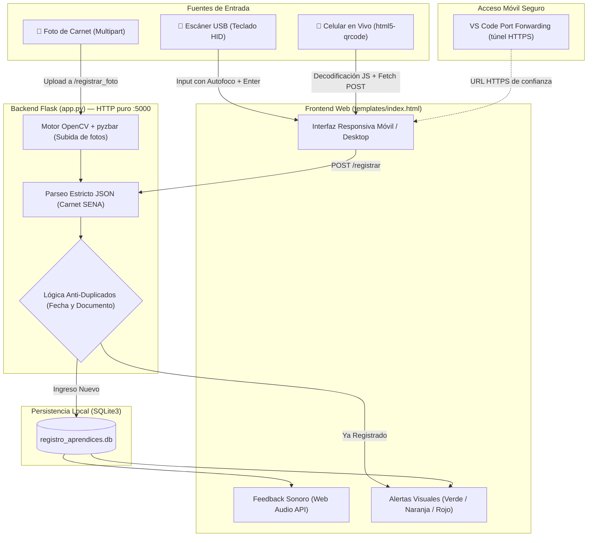

# 🎓 Sistema de Control de Asistencia SENA (Web & Hardware)

Sistema integral y modular para el registro, validación y persistencia de asistencia de aprendices mediante la lectura de códigos QR de carnets institucionales del **SENA**.

Diseñado para soportar múltiples fuentes de entrada:

1. **Escáner Físico USB (Pistola de Códigos de Barras / QR vía emulación de teclado HID)**.
2. **Cámara Móvil Inalámbrica en Vivo (navegador del teléfono vía túnel HTTPS de VS Code)**.
3. **Captura Fotográfica de Carnets (Procesamiento y decodificación en backend con OpenCV y pyzbar)**.

---

## 📌 Resumen de la Arquitectura Actual

El sistema es **local-first**: un único servidor Flask corre de forma **nativa en HTTP puro** en `localhost:5000` y guarda todo en una base de datos SQLite local. No requiere certificados, ni OpenSSL, ni configurar HTTPS en la red local.

El acceso desde el celular se resuelve con el **Port Forwarding (túneles) de Visual Studio Code**: VS Code expone el puerto `5000` de tu PC a través de una **URL HTTPS pública de confianza**. Como esa URL es un contexto seguro, el navegador del celular permite usar la cámara en vivo sin advertencias ni certificados instalados.

> **Por qué este enfoque:** los navegadores móviles solo habilitan `getUserMedia` (cámara en vivo) en *contextos seguros* (`https://` o `http://localhost`). El túnel de VS Code entrega ese HTTPS "gratis", evitando instalar RootCA, configurar OpenSSL o forzar TLS en Flask.

---

## 🏗️ Arquitectura del Sistema



**Flujo de datos:**

1. El aprendiz presenta su carnet; el QR se lee por cámara móvil, escáner USB o foto.
2. El string se envía a `/registrar` (o la foto a `/registrar_foto`).
3. El backend parsea el JSON del carnet y valida campos obligatorios (`nom`, `doc`).
4. La lógica anti-rebote consulta SQLite por `documento` + `fecha` del día.
5. Si es nuevo, lo inserta y responde `"exitoso"`; si ya existe, responde `"duplicado"`.
6. El frontend muestra alerta visual + sonido y refresca la tabla de registros del día.

---

## 📁 Estructura del Proyecto

```text
Asistencia_QR/
│
├── app.py                          # Servidor Flask principal y API REST (HTTP puro)
├── requirements.txt                # Dependencias del proyecto
├── test_endpoints.py               # Suite de pruebas automatizadas (6/6 passing)
├── ver_registros.py                # Herramienta CLI para consultar asistencias
├── iniciar_servidor.bat            # Lanzador rápido para Windows (HTTP local)
├── progress.md                     # Bitácora de seguimiento y estado del proyecto
├── ESTADO_Y_DIAGNOSTICO_TECNICO.md # Informe técnico detallado de arquitectura
├── README.md                       # Documentación del repositorio
│
├── templates/
│   └── index.html                  # Frontend HTML5 + CSS3 + JS (html5-qrcode)
│
└── [Generados automáticamente al ejecutar]:
    └── registro_aprendices.db      # Base de datos SQLite local
```

---

## 🚀 Inicio Rápido

### 1. Requisitos Previos
- Python 3.8 o superior instalado.
- Visual Studio Code (para el acceso desde el celular mediante túneles).

### 2. Instalación de Dependencias
```powershell
pip install -r requirements.txt
```

> **Nota para Windows:** `pyzbar` incluye binarios precompilados. Si tu entorno reporta falta de bibliotecas compartidas, asegúrate de tener instalado el [Visual C++ Redistributable](https://aka.ms/vs/17/release/vc_redist.x64.exe).

### 3. Iniciar el Servidor (HTTP local)

Haz **doble clic en `iniciar_servidor.bat`** o ejecuta en la consola:

```powershell
python app.py
```

El servidor inicia en **HTTP puro** en el puerto `5000`:
- **En este PC**: [http://localhost:5000](http://localhost:5000)

Para el acceso desde el celular, continúa con la sección **"Ejecución y Acceso desde Móvil"**.

---

## 📱 Ejecución y Acceso desde Móvil (Port Forwarding de VS Code)

El servidor **no usa HTTPS local ni certificados**. La conexión segura que exige la cámara del celular la proporciona el túnel de VS Code. Sigue estos pasos:

### Paso 1 — Inicia el servidor en HTTP local
Ejecuta `iniciar_servidor.bat` o `python app.py`. Debe quedar escuchando en `http://localhost:5000`. **No cierres esa ventana.**

### Paso 2 — Abre la pestaña "Puertos" en VS Code
En VS Code, abre la vista **Ports / Puertos** (normalmente en el Panel inferior, junto a *Terminal*, *Problems*, *Output*). También puedes llegar con el comando **"Ports: Focus on Ports View"** desde la Paleta de Comandos.

> Si no ves la pestaña, asegúrate de que el proyecto esté abierto en VS Code.

### Paso 3 — Reenvía (Forward) el puerto 5000
Pulsa **"Forward a Port / Reenviar un puerto"** e introduce `5000`.
- VS Code mostrará una fila para el puerto `5000` con una **URL de reenvío**.
- Esa URL tiene la forma `https://<nombre-aleatorio>-5000.app.github.dev` (o similar).

### Paso 4 — Abre la URL HTTPS en el celular
- Verifica que la visibilidad del puerto esté en **Public** si necesitas abrirlo desde una red distinta (haz clic derecho sobre el puerto → *Port Visibility* → *Public*).
- En el celular, abre en el navegador **exactamente** esa **URL `https://…`** (no la IP local, no `http://`).
- Al pulsar **"📷 Activar Cámara en Vivo"**, el navegador pedirá permiso de cámara y funcionará sin advertencias de seguridad ni instalación de certificados.

### Alternativa — Modo Foto (respaldo universal)
Si no deseas usar el túnel, el botón **"📸 Tomar Foto al Carnet"** funciona incluso sin HTTPS: la cámara nativa del teléfono captura la foto y el servidor la decodifica con OpenCV + pyzbar.

> **Nota:** el túnel HTTPS de VS Code es útil tanto en red local como desde fuera de ella, siempre que tu PC tenga conexión a internet.

---

## 🛠️ Modos de Operación

### 1. 🔌 Escáner Físico USB (Pistola de Códigos)
- Los escáneres QR por USB operan bajo el protocolo HID (emulación de teclado): inyectan el string completo y envían la tecla `Enter`.
- La interfaz web incluye un campo de texto con **autoenfoque permanente**.
- Conecta el lector a cualquier puerto USB, abre `http://localhost:5000` y escanea el carnet. El sistema lo procesará instantáneamente sin necesidad de tocar el teclado o ratón.

### 2. 📱 Modo Celular / Móvil (Cámara Inalámbrica vía Túnel HTTPS)
- Sigue la sección **"Ejecución y Acceso desde Móvil"**.
- El servidor corre en HTTP local y VS Code lo publica por HTTPS.
- Pulsa **"📷 Activar Cámara en Vivo"** y enfoca los carnets. La decodificación ocurre en el navegador (`html5-qrcode`) y el resultado se envía a `/registrar`.

### 3. 📸 Modo Foto (Respaldo Universal sin Túnel)
- Pulsa el botón azul **"📸 Tomar Foto al Carnet"**.
- Se abre la cámara nativa del teléfono y la foto se envía al endpoint `/registrar_foto`.
- El servidor la procesa con OpenCV y pyzbar en la computadora, permitiendo registrar carnets desde cualquier celular o navegador sin necesidad de túnel ni certificados.

---

## 🪪 Formato del Carnet SENA y Reglas de Negocio

El sistema realiza un **parseo estricto de JSON**, adaptado al formato exacto de los carnets institucionales:

```json
{
  "nom": "Diego Alejandro Arboleda Cuero",
  "doc": "CC 1087834596",
  "cargo": "Aprendiz",
  "rh": "O+",
  "ficha": "3564995",
  "dep": "9220",
  "prog": "ANALISIS Y DESARROLLO DE SOFTWARE - 228118 V1"
}
```

### Reglas del Sistema:
1. **Parseo Seguro**: Se captura el string y se parsea con `try ... except json.JSONDecodeError`. Si el código QR escaneado es ajeno al SENA o texto plano, se rechaza con HTTP `400 Bad Request` sin interrumpir el servidor.
2. **Anti-Rebote (Anti-Duplicados)**: Verifica si el `documento` ya cuenta con registro en la `fecha` actual (`YYYY-MM-DD`).
   - Si no existe: Inserta el registro y devuelve `"status": "exitoso"`.
   - Si ya existe: Omite la inserción y devuelve `"status": "duplicado"`.

---

## 📡 Especificación de la API REST

| Método | Endpoint | Descripción | Payload / Respuesta |
| :--- | :--- | :--- | :--- |
| `GET` | `/` | Sirve la interfaz web responsive | HTML |
| `POST` | `/registrar` | Registra asistencia desde string QR | Body: `{"qr_data": "<JSON_CARNET>"}` |
| `POST` | `/registrar_foto` | Sube y procesa una foto con OpenCV | Form-data: `foto` (archivo de imagen) |
| `GET` | `/api/asistencias/hoy` | Consulta asistencias del día en tiempo real | JSON: `{"total": N, "registros": [...]}` |

---

## 🗄️ Base de Datos (SQLite)

Motor SQLite3 en modo `WAL` para alta concurrencia, con la tabla `asistencia`:

```sql
CREATE TABLE IF NOT EXISTS asistencia (
    id INTEGER PRIMARY KEY AUTOINCREMENT,
    documento TEXT NOT NULL,
    nombre TEXT NOT NULL,
    ficha TEXT,
    programa TEXT,
    datos_qr TEXT NOT NULL,
    fecha TEXT NOT NULL,
    hora TEXT NOT NULL
);
```

La base de datos (`registro_aprendices.db`) se crea automáticamente al iniciar el servidor.

---

## 📊 Consulta de Registros (CLI)

Para consultar los registros almacenados en la base de datos sin abrir herramientas externas:

```powershell
python ver_registros.py
```

Salida esperada:
```text
=========================================================================================================
REGISTROS DE ASISTENCIA SENA: D:\Repositorios\Asistencia_QR\registro_aprendices.db
=========================================================================================================
ID   | FECHA      | HORA     | DOCUMENTO      | FICHA     | APRENDIZ                     | PROGRAMA
---------------------------------------------------------------------------------------------------------
1    | 2026-10-11 | 22:22:05 | CC 1087834596  | 3564995   | Diego Alejandro Arboleda C.. | ANALISIS Y DES...
=========================================================================================================
```

---

## 🧪 Pruebas Automatizadas

El proyecto incluye una suite completa de pruebas unitarias y de integración que validan los endpoints y la lógica de negocio:

```powershell
python test_endpoints.py
```

Salida esperada:
```text
[PASS] Test 1: Ruta raíz '/' sirve HTML correctamente.
[PASS] Test 2: Primer registro exitoso.
[PASS] Test 3: Anti-rebote confirmado (Ya registrado hoy).
[PASS] Test 4: QR no JSON rechazado limpiamente (400 Bad Request).
[PASS] Test 5: JSON sin datos de carnet rechazado con error 400.
[PASS] Test 6: API /api/asistencias/hoy reporta registros en vivo.

==============================================
TODAS LAS PRUEBAS DE ARQUITECTURA PASARON (6/6)
==============================================
```

---

## 👨‍💻 Autor

- **Diego Alejandro Arboleda Cuero**  
  *Ingeniero Electrónico • Aprendiz ADSO SENA (Ficha 3564995)*  
  GitHub: [@diarboledac](https://github.com/diarboledac)
